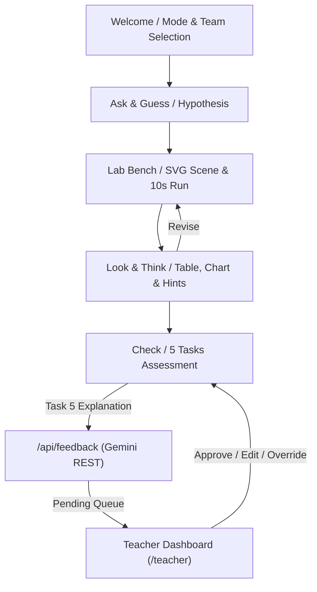

# 02. System Architecture & Technical Design

**Application:** Bubble Lab 🌱 · Course: ET617 · Roll No: 23B2525

---

## 1. Component Architecture & Data Flow

---

## 2. Component Hierarchy
- `App.tsx`: Routes (`/`, `/ask`, `/lab`, `/look`, `/check`, `/teacher`, `/about`)
  - `Layout.tsx`: Header (team, mode, level chips) + Footer (`ET617 · Roll No: 23B2525`)
  - `ProgressStrip.tsx`: Step indicators (1. Guess ➔ 2. Test ➔ 3. Think ➔ 4. Check)
  - `LabScene.tsx`: Pure hand-written SVG beaker, Hydrilla plant, movable lamp, thermometer, and bubble keyframes
  - `BarChart.tsx`: Hand-crafted SVG bar chart with striped pattern for unfair trials
  - `DetectiveHints.tsx`: 4-step ladder (Reflect ➔ Compare ➔ Suggest ➔ Revise)
  - `TeacherQueueItem.tsx`: Approve / Edit / Override UI controls

---

## 3. Data Storage & Cross-Tab Synchronization
All state persists in `localStorage` under `bubblelab.v1`.
1. **Window Storage Event:** Instantly updates when another tab alters storage.
2. **2-Second Polling:** Guarantees sync between Teacher Dashboard and Student tablets on the same device without requiring WebSockets or a cloud database.
